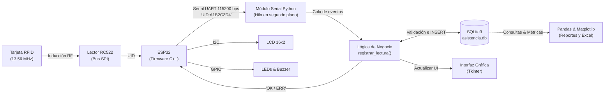
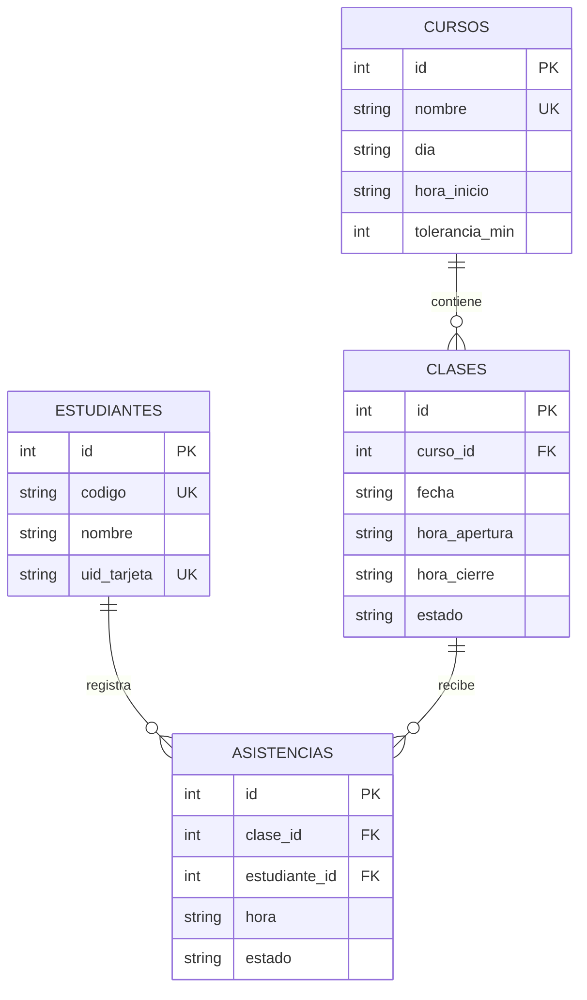

# 🎓 Sistema Inteligente de Control de Asistencia con RFID

[](https://www.python.org/)
[](https://www.espressif.com/)
[](https://www.sqlite.org/)
[](LICENSE)

Sistema integral de registro y gestión de asistencia académica en tiempo real. Utiliza tecnología de identificación por radiofrecuencia (**RFID 13.56 MHz**) mediante un microcontrolador **ESP32** acoplado a una aplicación de escritorio desarrollada en **Python** (Tkinter), con almacenamiento relacional en **SQLite** y motor analítico con **Pandas** y **Matplotlib**.

---

## 📌 Tabla de Contenidos

* [Características Principales](#-características-principales)
* [Arquitectura del Sistema](#-arquitectura-del-sistema)
* [Hardware y Conexiones](#-hardware-y-conexiones)
* [Protocolo de Comunicación Serial](#-protocolo-de-comunicación-serial)
* [Instalación y Puesta en Marcha](#-instalación-y-puesta-en-marcha)
  * [1. Carga del Firmware en el ESP32](#1-carga-del-firmware-en-el-esp32)
  * [2. Instalación de la Aplicación en Python](#2-instalación-de-la-aplicación-en-python)
* [Reglas del Negocio y Lógica de Asistencia](#-reglas-del-negocio-y-lógica-de-asistencia)
* [Modo Simulación (Sin Hardware)](#-modo-simulación-sin-hardware)
* [Estructura del Proyecto](#-estructura-del-proyecto)
* [Modelo de Base de Datos](#-modelo-de-base-de-datos)
* [Scripts de Prueba y Diagnóstico](#-scripts-de-prueba-y-diagnóstico)
* [Solución de Problemas Frecuentes](#-solución-de-problemas-frecuentes)
* [Licencia](#-licencia)

---

## ✨ Características Principales

* ⚡ **Detección Instantánea (< 500 ms):** Lectura física de tarjetas o llaveros RFID mediante bus SPI.
* 🚥 **Retroalimentación Audiovisual Sincronizada:** Indicadores LED de estado (verde para éxito, rojo para rechazo), alertas acústicas mediante zumbador piezoeléctrico y visualización dinámica en LCD 16x2 (I2C) con caracteres en español dibujados en memoria (tildes y eñes).
* 🧵 **Arquitectura No Bloqueante (Multithreading):** Comunicación serial asíncrona mediante un hilo demonio (`threading.Thread`) y una cola de eventos segura (`queue.Queue`) que mantiene la interfaz gráfica 100% fluida.
* 🔒 **Integridad de Datos Garantizada:** Base de datos SQLite normalizada con claves foráneas activas (`PRAGMA foreign_keys = ON`) y restricción `UNIQUE (clase_id, estudiante_id)` para impedir doble marcación.
* 📊 **Analítica y Reportes Automatizados:** Cálculo matricial de porcentajes de asistencia por alumno (`pd.crosstab`), historial de llegadas tarde por fecha y detección de alumnos en riesgo de deserción por ausencias acumuladas (`UMBRAL_FALLAS`).
* 📗 **Exportación Optimizada a Excel:** Generación de libros `.xlsx` mediante OpenPyXL con ajuste dinámico de columnas e inmovilización de paneles de encabezado.
* 🧪 **Modo Simulación Integrado:** Permite registrar asistencias y validar la lógica académica completa digitando el código estudiantil o UID directamente desde el teclado, sin necesidad de contar con el lector físico conectado.

---

## 🏛 Arquitectura del Sistema

El proyecto opera bajo un modelo desacoplado: el microcontrolador actúa como periférico de entrada/salida y Python administra la persistencia y la lógica.



---

## 🔌 Hardware y Conexiones

### Componentes Utilizados
* 1x Microcontrolador **ESP32 NodeMCU** (30 o 38 pines).
* 1x Módulo lector **RFID RC522** con tarjetas/llaveros compatibles ISO/IEC 14443A.
* 1x Pantalla **LCD 16x2** con módulo adaptador **I2C PCF8574** (dirección `0x27` o `0x3F`).
* 1x Zumbador (Buzzer) activo o pasivo de 5V/3.3V.
* 2x Diodos LED (Verde y Rojo) con 2 resistencias limitadoras de corriente de 220 Ω.
* Cable USB de datos (comunicación UART con chip CH340 / CP2102).

### Diagrama de Pinout

| Módulo | Pin del Módulo | Pin del ESP32 | Notas Técnicas |
|:---|:---|:---|:---|
| **RC522 (RFID)** | SDA (SS) | **GPIO 13** | Chip Select (SPI) |
| **RC522 (RFID)** | SCK | **GPIO 18** | Reloj de bus SPI |
| **RC522 (RFID)** | MOSI | **GPIO 23** | Salida Master / Entrada Slave |
| **RC522 (RFID)** | MISO | **GPIO 19** | Entrada Master / Salida Slave |
| **RC522 (RFID)** | RST | **GPIO 4** | Pin de reinicio de hardware |
| **RC522 (RFID)** | 3.3V | **3V3** | ⚠️ **PELIGRO: Alimentar solo a 3.3V. Conectar a 5V daña el integrado.** |
| **RC522 (RFID)** | GND | **GND** | Masa común |
| **LCD 16x2 I2C** | SDA | **GPIO 21** | Línea de datos I2C |
| **LCD 16x2 I2C** | SCL | **GPIO 22** | Línea de reloj I2C |
| **LCD 16x2 I2C** | VCC | **VIN (5V)** | Alimentación para backlight y contraste óptimo |
| **LCD 16x2 I2C** | GND | **GND** | Masa común |
| **Zumbador** | Ánodo (+) | **GPIO 15** | Salida digital / PWM |
| **Zumbador** | Cátodo (−) | **GND** | Masa común |
| **LED Verde** | Ánodo (+) | **GPIO 26** | Señalización de lectura aceptada (con resistencia 220 Ω) |
| **LED Rojo** | Ánodo (+) | **GPIO 27** | Señalización de rechazo/error (con resistencia 220 Ω) |
| **LEDs** | Cátodos (−) | **GND** | Conexión común a tierra |

---

## 📡 Protocolo de Comunicación Serial

La comunicación bidireccional opera a **115200 baudios**. Cada trama es una cadena de texto terminada en salto de línea (`\n`):

| Emisor | Trama enviada | Significado y Acción resultante |
|:---|:---|:---|
| **ESP32 → PC** | `READY` | El microcontrolador ha completado su inicio y configuración. |
| **ESP32 → PC** | `UID:A1B2C3D4` | Se detectó una tarjeta RFID con UID hexadecimal `A1B2C3D4`. |
| **ESP32 → PC** | `PONG` | Respuesta al comando de verificación de enlace de la aplicación. |
| **PC → ESP32** | `OK:linea1\|linea2` | **Lectura Aceptada:** Enciende LED verde, 1 pitido y proyecta texto en LCD. |
| **PC → ESP32** | `ERR:linea1\|linea2` | **Lectura Rechazada:** Enciende LED rojo, 3 pitidos de alerta y texto en LCD. |
| **PC → ESP32** | `MSG:linea1\|linea2` | Actualiza el mensaje en reposo de la pantalla LCD sin activar alertas. |
| **PC → ESP32** | `PING` | Comprueba que el microcontrolador esté conectado y respondiendo. |

> ℹ️ El carácter pleca (`|`) separa la línea superior (máximo 16 caracteres) de la inferior del LCD.

---

## 🚀 Instalación y Puesta en Marcha

### 1. Carga del Firmware en el ESP32

1. Conectar la placa ESP32 a la computadora mediante cable USB.
2. Abrir el software **Arduino IDE** (v1.8.x o v2.x).
3. Asegurarse de tener instalado el paquete de placas ESP32 en el Gestor de Tarjetas (`https://dl.espressif.com/dl/package_esp32_index.json`).
4. Instalar las siguientes librerías desde el **Gestor de Librerías**:
   * `MFRC522` (por *GithubCommunity / miguelbalboa*).
   * `LiquidCrystal_PCF8574` (por *Matthias Hertel*).
5. Abrir el archivo `firmware/lector_rfid/lector_rfid.ino`.
6. Si utiliza un zumbador pasivo, cambie la constante en la línea 58:
   ```cpp
   const bool BUZZER_PASIVO = true;
   ```
7. Seleccione la placa (*ESP32 Dev Module*) y el puerto COM correspondiente.
8. Suba el código a la placa. Al finalizar, el LCD mostrará: `Asistencia RFID / Pase su tarjeta`.

---

### 2. Instalación de la Aplicación en Python

Se recomienda utilizar un entorno virtual para aislar las dependencias:

```bash
# 1. Clonar el repositorio
git clone https://github.com/TU_USUARIO/TU_REPOSITORIO.git
cd TU_REPOSITORIO

# 2. Crear y activar un entorno virtual
python -m venv .venv

# En Windows (PowerShell):
.venv\Scripts\Activate.ps1
# En Linux / macOS:
source .venv/bin/activate

# 3. Instalar librerías requeridas
pip install -r requirements.txt

# 4. Iniciar la aplicación
python main.py
```

---

## 📋 Reglas del Negocio y Lógica de Asistencia

Cada lectura recibida pasa por una máquina de validaciones secuencial implementada en `logica/asistencia.py`:

```
Tarjeta leída
     │
     ▼
¿Hay una clase abierta? ──────────── No ───> [RECHAZO: 'No hay clase abierta']
     │ Sí
     ▼
¿El UID pertenece a un alumno? ───── No ───> [RECHAZO: 'Tarjeta NO REGISTRADA']
     │ Sí
     ▼
¿El alumno ya marcó hoy? ─────────── Sí ───> [RECHAZO: 'YA REGISTRADO']
     │ No
     ▼
¿Hora actual <= Inicio + Tolerancia?
     ├──── Sí ───> [ACEPTADA: 'A TIEMPO']
     └──── No ───> [ACEPTADA: 'TARDE']
```

| Condición del Registro | Clasificación | Respuesta del Hardware |
|:---|:---|:---|
| Llegada $\le$ `hora_inicio` + `tolerancia_min` | **A tiempo** | LED verde fijo + 1 pitido corto |
| Llegada $>$ `hora_inicio` + `tolerancia_min` | **Tarde** | LED verde fijo + 1 pitido corto |
| Tarjeta no vinculada a ningún estudiante | **Rechazada** | LED rojo fijo + 3 pitidos de alerta |
| Alumno con marca previa en la misma clase | **Rechazada** | LED rojo fijo + 3 pitidos de alerta |
| Tarjeta leída sin clase activa abierta | **Rechazada** | LED rojo fijo + 3 pitidos de alerta |
| Cierre formal de la sesión de clase | **Ausente** | Marcación masiva automática en SQL |

---

## 💻 Modo Simulación (Sin Hardware)

Para evaluar, demostrar o utilizar el sistema en equipos que no dispongan del lector físico conectado:

1. Inicie la aplicación con `python main.py`.
2. En la barra superior, no es necesario conectar ningún puerto COM (la app arrancará en estado desconectado).
3. Vaya a la pestaña **Registro en vivo**.
4. Abra una clase existente.
5. En la sección inferior **Modo simulación**, digite el código de la tarjeta (UID) o directamente el **código estudiantil** (ejemplo: `SIM00001` o `20241001`).
6. Presione Enter o haga clic en **Registrar**: el sistema ejecutará exactamente las mismas reglas de validación de horarios, registrará en SQLite y actualizará la tabla.

---

## 🗂 Estructura del Proyecto

```
Proyecto_Registro_RFID/
├── main.py                  # Punto de entrada de la aplicación
├── config.py                # Variables de configuración global y rutas
├── requirements.txt         # Especificación de paquetes Python requeridos
├── LICENSE                  # Licencia No Comercial CC BY-NC 4.0
├── .gitignore               # Exclusiones de Git (bases locales, cachés, venvs)
│
├── firmware/
│   └── lector_rfid/
│       └── lector_rfid.ino  # Firmware C++ para ESP32 (Arduino IDE)
│
├── database/                # Capa de Acceso a Datos (DAO / Repositorio)
│   ├── conexion.py          # Conexión SQLite, row_factory y creación de tablas
│   ├── estudiantes.py       # Operaciones CRUD para alumnos y UIDs
│   ├── cursos.py            # Gestión de materias, días y tolerancia
│   ├── clases.py            # Apertura, cierre y estado de sesiones
│   └── asistencias.py       # Consultas, registro transaccional y ausencias
│
├── logica/                  # Reglas del Negocio y Procesamiento
│   ├── asistencia.py        # Motor de validación horaria y estados
│   ├── reportes.py          # Agregaciones estadísticas y alertas con Pandas
│   └── exportar.py          # Generador de hojas de cálculo Excel con OpenPyXL
│
├── hardware/
│   └── lector_serial.py     # Manejo concurrente de puerto COM con Pyserial y colas
│
├── ui/                      # Presentación Gráfica (Tkinter)
│   ├── app.py               # Ventana principal, navegación por pestañas y polling
│   ├── vista_registro.py    # Pantalla de control de clase en vivo y simulación
│   ├── vista_estudiantes.py # Formulario y vinculación de tarjetas RFID
│   ├── vista_cursos.py      # Configuración de horarios y tolerancias
│   ├── vista_consultas.py   # Filtros dinámicos y exportación a Excel
│   └── vista_reportes.py    # Gráficos con Matplotlib y alertas de faltas
│
├── scripts/                 # Utilidades de desarrollo y pruebas
│   ├── datos_prueba.py      # Poblador de datos de prueba (alumnos, cursos, clases)
│   ├── probar_bd.py         # Test de integridad del motor SQLite
│   ├── probar_logica.py     # Pruebas unitarias de las reglas de asistencia
│   └── probar_lector.py     # Monitor interactivo para diagnóstico del lector
│
└── data/                    # Directorio de persistencia local
    ├── .gitkeep             # Control de versiones
    ├── asistencia.db        # Archivo de base de datos SQLite (generado en ejecución)
    └── exportes/            # Carpeta contenedora de reportes .xlsx exportados
```

---

## 🗄 Modelo de Base de Datos

El diseño relacional normalizado cuenta con cuatro entidades en SQLite:



---

## 🔬 Scripts de Prueba y Diagnóstico

Para garantizar el funcionamiento de cada componente de forma aislada, se proporcionan utilidades en la carpeta `scripts/`:

```bash
# Cargar datos ficticios (20 alumnos, cursos y clases históricas):
python scripts/datos_prueba.py

# Si desea limpiar la base de datos por completo y cargar datos limpios:
python scripts/datos_prueba.py --reiniciar

# Verificar que la base de datos responda y cree sus tablas:
python scripts/probar_bd.py

# Validar que los cálculos de tolerancia horaria funcionen según lo previsto:
python scripts/probar_logica.py

# Probar la recepción de tarjetas desde la terminal sin abrir la interfaz:
python scripts/probar_lector.py
```

---

## 🛠 Solución de Problemas Frecuentes

| Síntoma | Causa Probable | Solución Recomendada |
|:---|:---|:---|
| **Error al abrir puerto COM** | El Monitor Serial de Arduino IDE u otro programa mantiene ocupado el puerto. | Cierre cualquier aplicación que use el puerto COM antes de pulsar «Conectar» en la app. |
| **El LCD enciende pero no muestra letras** | El contraste del potenciómetro I2C está desajustado. | Gire suavemente el tornillo potenciómetro azul en la parte trasera del módulo I2C con un destornillador. |
| **El LCD indica «Sin respuesta»** | El ESP32 no recibió el comando `OK` o `ERR` de Python en menos de 3 segundos. | Verifique que la aplicación esté abierta, conectada al puerto correcto y con una clase abierta. |
| **El lector no detecta tarjetas** | Cableado SPI incorrecto o módulo energizado con voltaje inadecuado. | Verifique la continuidad de los cables Dupont y corrobore que el pin 3.3V del RC522 esté conectado a **3V3** (no a 5V). |
| **Todos los alumnos quedan «Tarde»** | La clase fue abierta en un horario posterior al configurado para el curso más su tolerancia. | Verifique que la hora configurada en la pestaña **Cursos** coincida con el horario real de la sesión. |

---

## 📄 Licencia

Este proyecto está distribuido bajo la licencia internacional:  
**Creative Commons Atribución-NoComercial 4.0 Internacional ([CC BY-NC 4.0](https://creativecommons.org/licenses/by-nc/4.0/deed.es))**

```text
Usted es libre de:
✓ Compartir — copiar y redistribuir el material en cualquier medio o formato.
✓ Adaptar — remezclar, transformar y crear a partir del material para propósitos educativos o de investigación.

Bajo las siguientes condiciones:
* Atribución — Debe dar crédito de manera adecuada y brindar un enlace a la licencia.
* No Comercial — No puede hacer uso del material con propósitos comerciales, lucrativos o de venta.
```

Para consultar los términos y restricciones legales completas, revise el archivo [LICENSE](LICENSE).
